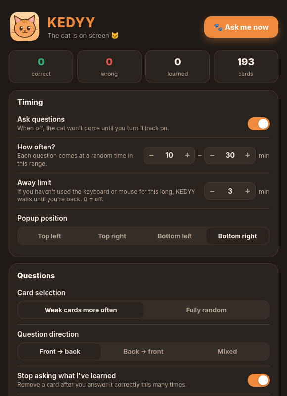

<p align="center">
  
</p>

<p align="center">
  
  
  
  
  
</p>

---

I was learning English from TV series, copying useful phrases into text files, and then never looking at them again. Flashcard apps had the same problem: they only work if you remember to open them.

So I flipped it around. KEDYY sits in the background, and every so often a cat slides into the corner of your screen with **one quick question from your own list**. Pick an answer, the cat cheers or sulks, and you're back to work in five seconds.

It started as an English thing, but a deck is just a text file, so it works for any language or topic: German nouns, kana, capitals, shell commands, exam terms.

https://github.com/user-attachments/assets/1ac5c14a-a455-47e9-8683-1de2fe31f7fa

<p align="center"><sub>What it looks like while I'm working</sub></p>

## How it works

1. **Write a deck.** A plain text file, one card per line: `der Hund — the dog`.
2. **Forget about it.** KEDYY runs in the background and picks a random moment, every 10–30 minutes by default.
3. **Answer the cat.** Four options, all taken from your own deck. Cards you miss come back more often.

## Features

<table>
  <tr>
    <td width="50%" valign="top">
      <b>Your cards, nothing made up</b><br>
      Every question and every wrong option comes from your deck.
    </td>
    <td width="50%" valign="top">
      <b>Learns what you don't know</b><br>
      Leitner boxes put missed cards back in rotation more often. You can also switch to fully random.
    </td>
  </tr>
  <tr>
    <td valign="top">
      <b>Knows when you're away</b><br>
      If you haven't touched the keyboard or mouse for a while, it waits until you're back.
    </td>
    <td valign="top">
      <b>Retires what you've learned</b><br>
      Optionally stops asking a card after you've answered it right N times.
    </td>
  </tr>
  <tr>
    <td valign="top">
      <b>Both directions</b><br>
      Front to back, back to front, or mixed.
    </td>
    <td valign="top">
      <b>Keyboard friendly</b><br>
      <kbd>1</kbd>–<kbd>4</kbd> to answer, <kbd>Esc</kbd> for later, <kbd>Enter</kbd> to close.
    </td>
  </tr>
  <tr>
    <td valign="top">
      <b>A cat with moods</b><br>
      It cheers, sulks and waves goodbye. Sound effects are optional.
    </td>
    <td valign="top">
      <b>Speaks your language</b><br>
      English, Turkish, Azerbaijani, German, Japanese and Russian, and adding one is a single JSON file.
    </td>
  </tr>
</table>

<p align="center">
  
</p>

## Install

You need Python 3 with the GTK 3 and WebKitGTK 4.1 bindings. On Debian, Ubuntu and derivatives:

```bash
sudo apt install python3-gi gir1.2-gtk-3.0 gir1.2-webkit2-4.1
```

Then:

```bash
git clone https://github.com/rickidevs/kedyy.git
cd kedyy
./install.sh
```

That's it. KEDYY shows up in your app menu and starts on login.

<details>
<summary>More about installing</summary>

- The script installs for your user only and doesn't need root. It adds a launcher, an icon and an autostart entry. Pass `--no-autostart` if you don't want the last one.
- KEDYY runs from the cloned folder, so keep it around.
- If something is missing, the script prints the package names for Fedora, Arch and openSUSE too.
- To try it without installing, just run `./bin/kedyy`.
- `./uninstall.sh` removes everything except your data, and `./uninstall.sh --purge` removes that as well.

</details>

## Usage

```
kedyy                 open the settings window
kedyy --now           ask a question right away
kedyy --background    start without a window (used by autostart)
```

The app menu entry has an **Ask me now** action too, if you'd rather not wait for the cat.

## Making a deck

```text
#! name: German basics
#! front: Deutsch
#! back: English

der Hund — the dog
die Stadt — the city (plural: die Städte)
Wie geht's? = How are you?
```

| What | How |
| --- | --- |
| Separator | `—`, `-`, `=`, `:`, `;` or a tab. Numbered lines like `12. ...` are fine. |
| Notes | Text in `( … )` at the end of the back is shown after you answer. |
| Deck info | Optional `#! name:`, `#! front:`, `#! back:` lines. `#! prompt:` changes the question, e.g. `What's the capital?` |
| Comments | Any other line starting with `#` is ignored. |
| CSV / TSV | Columns: front, back, and an optional note. |

Some sample decks to start with are in [`examples/`](examples): German, Spanish, hiragana, world capitals and Linux commands. They're copied on first start, and you can remove them in settings.

## Translations

Interface strings live in [`kedyy/locales/`](kedyy/locales). Copy `en.json` to `<code>.json`, translate the values, and set `_name` to the language's own name. Anything missing falls back to English.

If you're a native speaker of one of the included languages and something sounds off, a fix is very welcome.

<details>
<summary>Under the hood</summary>

- GTK 3 windows. The popup and the settings are HTML rendered with WebKitGTK.
- Wayland doesn't let apps position their own windows, so KEDYY runs through XWayland (`GDK_BACKEND=x11`) to sit in a corner.
- Idle detection tries GNOME's IdleMonitor, then the freedesktop ScreenSaver interface (KDE), then `xprintidle`.
- Decks, settings and progress live in `~/.local/share/kedyy`. Nothing is sent anywhere.
- Developed and tested on Zorin OS 18 (GNOME, Wayland). Reports from other desktops are welcome.

</details>

## Roadmap

- [ ] Import Anki decks (`.apkg`)
- [ ] Read the front side aloud
- [ ] A practice mode for drilling a whole range of cards at once
- [ ] Flatpak and AUR packages

## License

[MIT](LICENSE)
